

  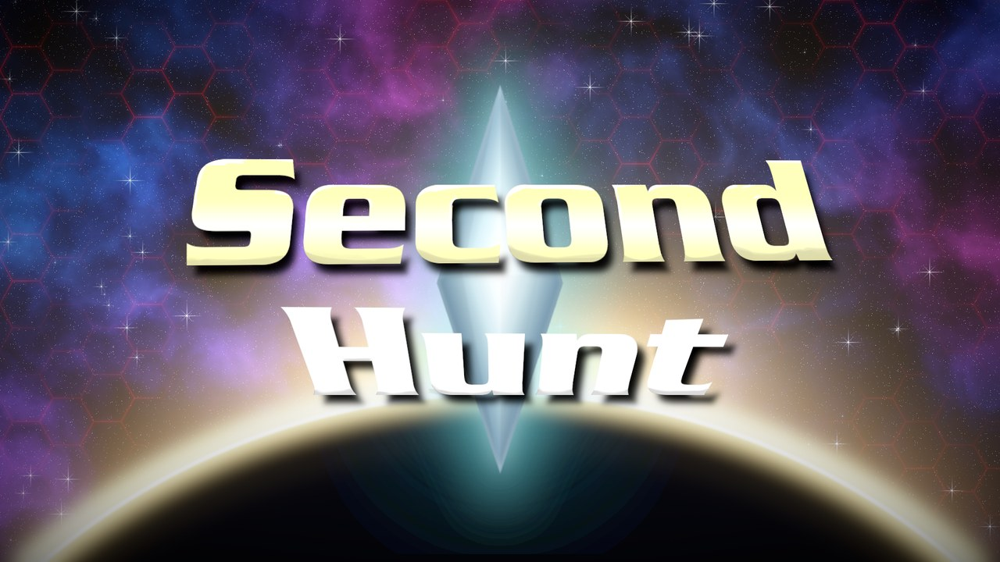

  
  

> If you are seeing this read me from a launcher like Quiver and you like Second Hunt, please consider 
> giving our repo a star on GitHub. It will help the game get noticed and increase the online player base!
> Thank you!

**Second Hunt is _Metroid Prime Hunters_ rebuilt as a native game for Android and Windows.** The full DS campaign and
multiplayer in true widescreen at 60 fps, with dual-stick controls (or keyboard and mouse on PC), LAN and online play
for up to 8 players, and new hunters, arenas and music made from your own Metroid Prime discs.

Second Hunt aims to modernize and add new features and content to the original Hunters experience. New weapons, playable characters, maps, and additional music are all already available and more is planned, all from user provided, legally obtained roms.

**Second Hunt contains no game data.** You need your own _Metroid Prime Hunters_ (USA) ROM, version 1.0 or 1.1. It's a
fan project, a fork of [MphRead](https://github.com/NoneGiven/MphRead), and isn't affiliated with or endorsed by
Nintendo.

<a href="https://github.com/BountyHunterKanden/SecondHunt/releases/latest">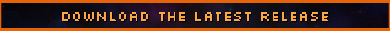</a> Android APK or Windows zip

<a href="https://github.com/BountyHunterKanden/SecondHunt/releases/latest">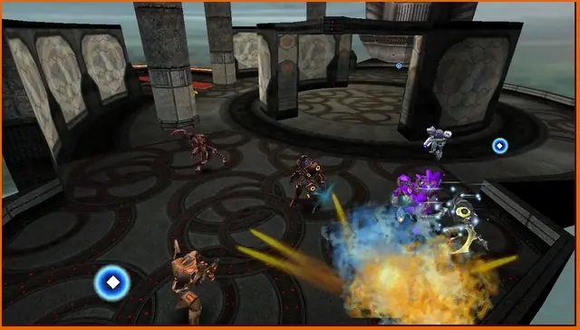</a>

> <a href="https://discord.gg/WkvJ5ddjye">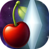</a> 
> **Join the Hunters Outpost Discord** for Second Hunt support or to discuss and play Second Hunt and related
> projects with other players! [Click here to join!](https://discord.gg/WkvJ5ddjye)

<a href="#contents">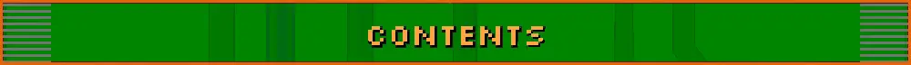</a>

- [Getting started](#getting-started)
- [Features](#features)
- [Known issues](#known-issues)
- [Help and bug reports](#help-and-bug-reports)
- [Credits](#credits)

More pages: [Features](https://github.com/BountyHunterKanden/SecondHunt/blob/master/docs/FEATURES.md) ·
[Controls](https://github.com/BountyHunterKanden/SecondHunt/blob/master/docs/CONTROLS.md) ·
[Installing and updating](https://github.com/BountyHunterKanden/SecondHunt/blob/master/docs/INSTALLING.md) ·
[Known issues and plans](https://github.com/BountyHunterKanden/SecondHunt/blob/master/docs/KNOWN_ISSUES.md) ·
[MphRead to-do list](https://github.com/BountyHunterKanden/SecondHunt/blob/master/docs/MPHREAD_TODO.md) ·
[Acknowledgements](https://github.com/BountyHunterKanden/SecondHunt/blob/master/docs/ACKNOWLEDGEMENTS.md)

<a href="#getting-started">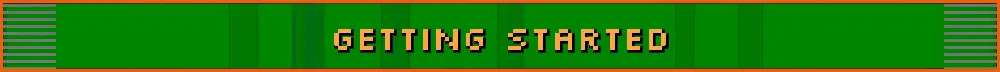</a>

**Android** (Android 8.0 or newer with OpenGL ES 3.0. A controller is recommended, but touch works too.)
1. Download the `.apk` from [Releases](https://github.com/BountyHunterKanden/SecondHunt/releases/latest).
2. Open it on your device. Android will ask you to allow installs from your browser or file manager.
3. On first launch, pick your ROM file. Second Hunt unpacks it once, and after that it goes straight into the game.

**Windows** (Windows 10 or 11, 64-bit, with OpenGL 3.3, and a keyboard and mouse or a controller)
1. Download the `.zip` from [Releases](https://github.com/BountyHunterKanden/SecondHunt/releases/latest) and unzip it
   anywhere you can write to (not Program Files).
2. Open `SecondHunt.exe`. If Windows says it protected your PC, click More info, then Run anyway.
3. On first launch, pick your ROM file or drop it on the window.
4. For LAN and online matches, allow Second Hunt through Windows Firewall when it asks.

Then, if you like, import your _Metroid Prime_ discs for HD suits, new hunters, _Echoes_ arenas and music (OPTIONS >
SECOND HUNT SETTINGS > IMPORT GAMES).

Updates install from inside the game. The main menu asks when a new version is out, and your saves and settings are
kept. Firewall help, portable mode and more are on the
[installing page](https://github.com/BountyHunterKanden/SecondHunt/blob/master/docs/INSTALLING.md).

<a href="#features">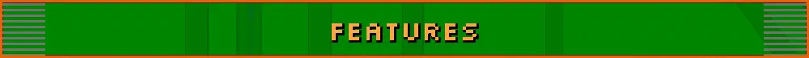</a>

<a href="#echoes-arenas-with-echoes-own-lighting">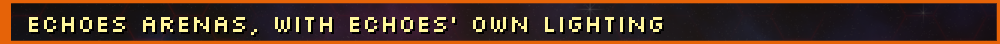</a>

Fight in _Metroid Prime 2: Echoes_ arenas made from your own disc: Sidehopper Station, Spires, Crossfire Chaos,
Pipeline, Spider Complex and Shooting Gallery. They're drawn the way _Echoes_ draws them, in HD, with its real
lighting, materials, effects, glass, water and skies. They play like _Echoes_ too, with double jump, Gravity Boost in
Pipeline's water, jump pads that replace morph ball cannons, and _Echoes_' multiplayer music.

**Shooting Gallery's turret works just like _Echoes_.** Climb in and rain fire on the arena, or roll into the slot
behind it in any alt form and blow it up.

  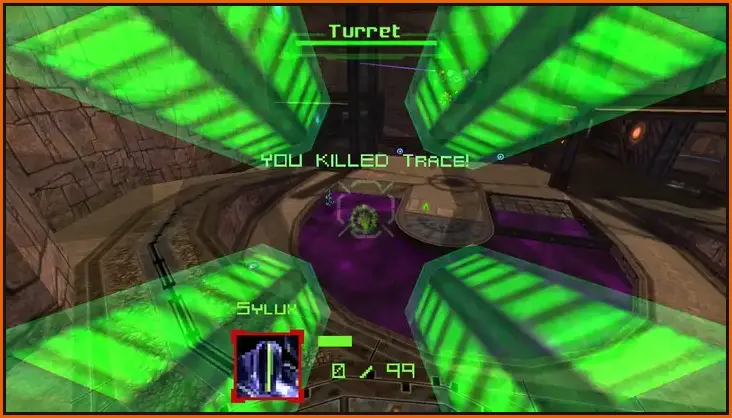
  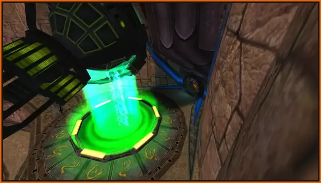

**Mining Plaza is a brand new arena.** It was never a multiplayer map. Second Hunt turns the Mining Plaza room from
_Echoes_' campaign into a full arena, with its doors sealed shut, new pickups and a chain of three jump pads across the
plaza.

<a href="#new-hunters">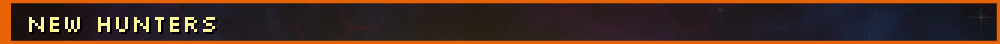</a>

- **The Pirate Trooper** from _Metroid Prime_: a Space Pirate with four skins, a wall cling and a Scout Drone alt form. His
  Pirate Blaster marks a target with a full burst (Squad Mark), showing them through walls to him and his team.
- **Dark Samus** from _Echoes_ or _Corruption_, with her final form from _Echoes_, **Overcharged Dark Samus**, as a skin
  with its own morph ball. No Dark Samus imported? Pick Limoki's low-poly Dark Samus.
- **HD Samus suits** from the _Metroid Prime Trilogy_ games you import, the beta Phazon Suit included, and **Sylux in his _Metroid Prime 4:
  Beyond_ suit**
- Playing with someone who hasn't imported a hunter? They still see you as a stand-in: the Pirate Trooper in his skin's
  colors, Dark Samus as Limoki's low-poly Dark Samus, and HD Samus or _Beyond_ Sylux as the original MPH Samus
  or Sylux.

  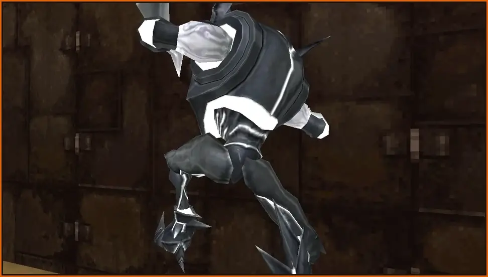
  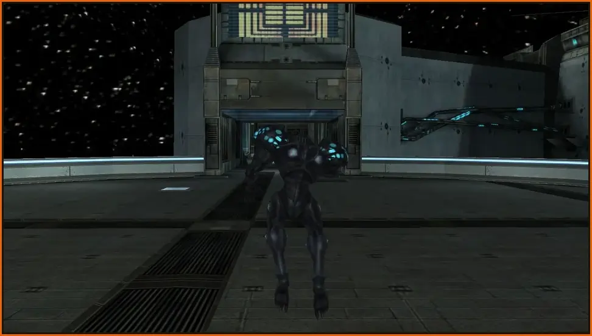
   
  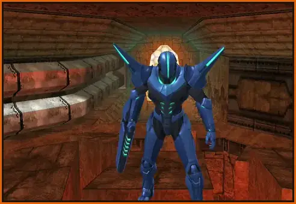

<a href="#online-for-up-to-8-players">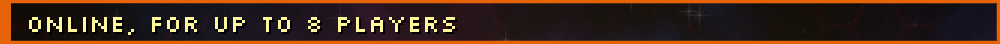</a>

- **8 players in every mode**, any mix of people and bots. Matches of 4 or fewer play exactly like the original.
- **Crossplay** between Android and Windows on Second Hunt's own servers. FIND GAME groups you with other players and
  everyone votes on the arena, or you can browse open games or host your own with your rules and bots.
- **Friends and parties**, voice chat (push to talk or always on) and text chat, a live scoreboard with everyone's ping,
  and automatic rejoin if your connection drops
- **LAN and bot matches** in every mode and arena. Bots run on the game's own bot code, take jump pads, ledges and
  drop-downs, and the new hunters fight as bots too.
- **The Hunter Hub**: the old Nintendo WFC Gaming Hub pages for _Hunters_, rebuilt in the game, with leaderboards and
  everyone's license stats
- **Hunter License**, rank and stats like the original. Bring your license over from your DS save, make the Pirate Trooper or
  Dark Samus your hunter of choice, and pick your color while seeing your hunter in each one.
- **STREAMING** switches hide your IP address, name and friend code on screen

<a href="#and-more">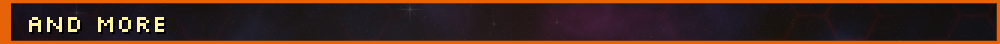</a>

- **The whole campaign**, from the opening to Gorea, with the game's own menus, gunship, cutscenes, scans and both
  endings. After your first clear, play it as any hunter, the Pirate Trooper included, and ALT FORM HOP lets every hunter
  reach where Samus's bombs can. Bring your DS save over, or export yours back out.
- **Replays** of your last ten matches, online ones included, with instant seeking, any player's view and a free
  camera. Send them to friends or save them as files.
- **Music from every Prime game** you import, picked song by song for matches, menus and the lobby, and HQ music that
  takes out the DS's clicks and clipping
- **Controls for today's hardware**: dual sticks, full rebinding, a weapon ring on L2, gyro aim with a gyro button, a
  touch overlay, stylus aim like the DS, and SDL3 controllers on Windows (Switch Pro included)
- **Looks and options**: field of view up to 130, AIM VIEW (the view follows your aim instantly, or trails it like the
  DS), ragdoll deaths, HUD sway and opacity, a hit direction indicator, the campaign radar from the DS touch screen,
  third person, the two DS screens merged into one, clean redrawn HUD lines, and the option to skip the boot logos
- **Plays like the original**: gameplay values are the DS game's, and anything that behaves differently is checked
  against it and fixed

<a href="#in-the-works">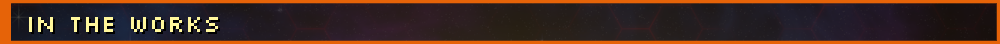</a>

- **_First Hunt_**, the demo that came with the DS, as its own mode from your own cart: its menus, the Regulator and
  Morph Ball rooms, Survivor and its multiplayer arenas
- **Zero Suit Samus**, with her own Paralyzer beam that stuns, and an army crawl for her alt form
- **Dark Samus's Hyper Mode**, with the Hyper Ball and Hyper Beam
- **The Spider Ball for every hunter** on _Echoes_' spider tracks, and the Grapple Beam
- **High frame rates**, 120 fps and up, with smooth frames on any screen
- **_First Hunt_'s death collapse** as a death animation
- **Lua mods** and game modes made as mods, and a **Hard Mode** campaign with enemies from _First Hunt_ and the
  Prime games

Everything in detail: [Features](https://github.com/BountyHunterKanden/SecondHunt/blob/master/docs/FEATURES.md) ·
[Controls](https://github.com/BountyHunterKanden/SecondHunt/blob/master/docs/CONTROLS.md)

<a href="#known-issues">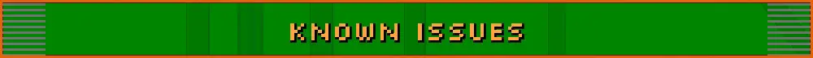</a>

- Only USA ROMs (1.0 and 1.1) work for now.
- No rumble yet.
- After you quit a LAN match from the pause menu you can't rejoin it (closing and reopening the app does).
- Some save details aren't kept yet: the best-time records, part of the game timer, a few stats and the artifact flags.
- Android's Play Protect may call the app harmful when you install it. Tap "More details", then "Install anyway".
  Google has been asked to review it.

The full list, and what's planned next:
[Known issues and plans](https://github.com/BountyHunterKanden/SecondHunt/blob/master/docs/KNOWN_ISSUES.md)

<a href="#help-and-bug-reports">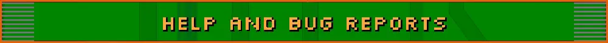</a>

If the game crashes, go to SECOND HUNT SETTINGS > APP > HELP > SHARE CRASH LOG (OPEN CRASH LOG on Windows) and attach
the report to a bug report on the [Issues](https://github.com/BountyHunterKanden/SecondHunt/issues) page, with your
device and what you were doing. It has no personal data in it. For a bad online match or anything else, SHARE LOG
(SAVE LOG on Windows) sends the game's log. You can also ask on the Discord above.

<a href="#credits">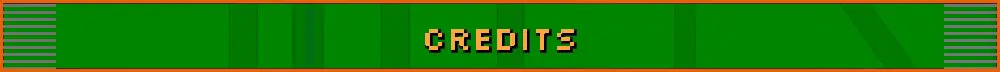</a>

Second Hunt is built on **[MphRead](https://github.com/NoneGiven/MphRead)** by NoneGiven, a C# recreation of the game
from reverse engineering.

Second Hunt wouldn't be where it is without these people:

- **[Fruity Prime](https://github.com/liveteklol/Fruity-Prime)** by liveteklol, another MphRead fork, for its netcode
  work. Second Hunt's served online matches run on a port of it, with the server in charge, hits checked by the server
  and a longer lag compensation rewind.
- **Limoki**, for the low-poly Dark Samus model that Dark Samus seats wear when no Dark Samus is imported, and the
  morph ball to match. The app builds them from your own game files plus Limoki's edits, so none of the
  game's art ships with it. Limoki also helped with the Second Hunt logo.
- **Everyone who reported issues on GitHub** that have since been fixed or added:
  - [@MusicGoat91](https://github.com/MusicGoat91): QUIT SECOND HUNT? on the title screen ([#3](https://github.com/BountyHunterKanden/SecondHunt/issues/3)),
    typing on the on-screen keyboards with a PC keyboard ([#4](https://github.com/BountyHunterKanden/SecondHunt/issues/4)), and side mouse buttons repeating
    next/previous weapon ([#2](https://github.com/BountyHunterKanden/SecondHunt/issues/2))
  - [@drencoss](https://github.com/drencoss): visor and helmet opacity settings ([#1](https://github.com/BountyHunterKanden/SecondHunt/issues/1))
  - [@EliParker28](https://github.com/EliParker28): SDL3 controller support on Windows, including the Switch Pro
    Controller ([#6](https://github.com/BountyHunterKanden/SecondHunt/issues/6))
  - [@JustinBenedick](https://github.com/JustinBenedick): look invert for X and Y separately, for an inverted mouse
    ([#10](https://github.com/BountyHunterKanden/SecondHunt/issues/10))
  - [@Swordman14](https://github.com/Swordman14): asking for a static reticle, which turned into AIM VIEW
    ([#11](https://github.com/BountyHunterKanden/SecondHunt/issues/11))
  - [@extracoconut](https://github.com/extracoconut): a portable mode on Windows, which turned into the DATA FOLDER
    choice ([#12](https://github.com/BountyHunterKanden/SecondHunt/issues/12))
- **Everyone on Discord**, including finRatman, Limoki and Yaba, and every player who has sent in bug reports, logs,
  replays, screenshots and videos. Second Hunt is a lot better for it.

<a href="#upstream-projects">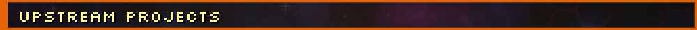</a>

Second Hunt also uses code and file format research from these projects:

- **MphRead's sources:** dsgraph, [Chemical's model format notes](https://gitlab.com/ch-mcl/metroid-prime-hunters-file-document/-/blob/master/Model/BinModel.md),
  McKay42's [mph-model-viewer](https://github.com/McKay42/mph-model-viewer) and
  [mph-arc-extractor](https://github.com/McKay42/mph-arc-extractor), Barubary's [dsdecmp](https://github.com/Barubary/dsdecmp),
  loveemu's [swav2wav](https://github.com/loveemu/loveemu-lab), Gericom's
  [ffmpeg patch](https://lists.ffmpeg.org/pipermail/ffmpeg-devel/2021-March/277774.html) and CharlesVanEeckhout's
  [actimagine decoder](https://github.com/CharlesVanEeckhout/actimagine) for the movies, CyberBotX's
  [NCSF](https://github.com/CyberBotX/NCSF) for the music, and hackyourlife's
  [mph-viewer](https://github.com/hackyourlife/mph-viewer).
- **Reading the Metroid Prime games:** AxioDL's [metaforce](https://gitlab.axiodl.com/AxioDL/metaforce),
  [PrimeWorldEditor](https://github.com/AxioDL/PrimeWorldEditor), [amuse](https://gitlab.axiodl.com/AxioDL/amuse) and
  [lzokay](https://github.com/AxioDL/lzokay), the [Retro Modding Wiki](https://wiki.axiodl.com), Dolphin's notes on the
  RVZ disc format, and Sun Microsystems' G.721 decoder for Prime music.
- **Libraries:** [OpenTK](https://github.com/opentk/opentk), [GLFW](https://github.com/glfw/glfw),
  [SDL](https://github.com/libsdl-org/SDL), [SoundFlow](https://github.com/LSXPrime/SoundFlow) with
  [miniaudio](https://github.com/mackron/miniaudio), [Concentus](https://github.com/lostromb/concentus) (Opus, for voice
  chat), [MoonSharp](https://github.com/moonsharp-devs/moonsharp), [ImageSharp](https://github.com/SixLabors/ImageSharp)
  and .NET.

The full list, with what each one was used for:
[Acknowledgements](https://github.com/BountyHunterKanden/SecondHunt/blob/master/docs/ACKNOWLEDGEMENTS.md)

> **AI tools were used in the making of this project.** 
