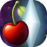

# Second Hunt

> If you are seeing this read me from a launcher like Quiver and you like Second Hunt, please consider 
> giving our repo a star on GitHub. It will help the game get noticed and increase the online player base!
> Thank you!

**Second Hunt is _Metroid Prime Hunters_ rebuilt as a native game for Android and Windows.** It plays the Nintendo DS
original campaign and multiplayer, in true widescreen, with dual-stick controller controls (or keyboard and mouse on PC)
and a one-screen HUD. It runs everything from your own copy of the game.

Second Hunt aims to modernize and add new features and content to the original Hunters experience. New weapons, playable characters, maps, and additional music are all already available and more is planned, all from user provided, legally obtained roms.

Second Hunt is a fan project and a fork of MphRead. It contains no game data from any Metroid game and isn't affiliated with or endorsed by Nintendo.

> **Beta 3.6 (0.3.6-beta, Android and Windows).** Smoother online matches on the Second Hunt server, replay sharing,
> ping on the scoreboard, Overcharged Dark Samus, and Sylux from _Metroid Prime 4: Beyond_. Playable start to finish,
> with some rough edges. See [Known issues](#known-issues) and [What's planned](#whats-planned).

>  
> **Join the Hunters Outpost Discord** for Second Hunt support or to discuss and play Second Hunt and related
> projects with other players! [Click here to join!](https://discord.gg/WkvJ5ddjye)

## What Second Hunt is

The game's logic (enemies, weapons, physics, rooms, scripting, bots) comes from
[MphRead](https://github.com/NoneGiven/MphRead), NoneGiven's C# recreation of the game, built from reverse engineering.
Second Hunt adds everything else it takes to play it on Android and Windows: the title screen and menus, the gunship,
star map and saves, the HUD, music and sound, cutscenes, controls, and LAN and online multiplayer. Both versions run the same game
code; only the window, the controls and the sound output are each platform's own.

All the game's content comes from your ROM. The first time you launch the app you pick your copy of the game, and
Second Hunt unpacks it into the app's own storage on your device or PC. The extras (HD suits, new characters, Echoes
arenas) are made the same way, in the app, from your own Metroid Prime discs (SECOND HUNT SETTINGS > IMPORT GAMES).
Nothing gets downloaded or uploaded, except the update check (at launch, it asks GitHub whether a newer Second Hunt
is out; you can turn that off in SECOND HUNT SETTINGS > UPDATE ALERTS), a new version when you say yes to one, and
online play, which talks to the Second Hunt server only while you use ONLINE PLAY.

Since the game is drawn natively instead of through an emulated DS, the 3D runs in real widescreen at your screen's
resolution, and at 60 fps instead of the DS's 30. The two DS screens become one: the HUD sits in the game view,
and the touch-screen controls (morph ball, weapon select, scan visor, dialog buttons) move to buttons. Controls are made
for a controller, laid out like _Metroid Prime Remastered_, with optional gyro aim and an optional touch overlay on
Android. On Windows the keyboard and mouse use MphRead's own PC controls.

The aim is for it to play like the DS game. When something behaves differently (a speed, a timing, a fire rate, a
sound), it is compared against the original game and fixed. Gameplay values aren't changed.

## What's in Beta 3.6

**Campaign**
- The whole adventure from the opening to Gorea: Celestial Archives, Alinos, Vesper Defense Outpost, Arcterra and the
  Oubliette
- The game's own title screen, attract movie, file select (three files, with copy and delete), options and credits,
  rebuilt from the menus in your ROM. You can tap or click the title screen's options, and on Windows QUIT TO DESKTOP
  sits in its lower left corner (and in the pause menu).
- The gunship: cockpit, ship menus, star map, planet select, and the landing and take-off movies
- Every cutscene, the HUD for every hunter, and the scan visor
- A pause map on Select, showing either the game's own map or a Prime-style map of the rooms you've explored
- The game's music and sound effects from your ROM, plus the title music and voices
- Both endings, with the credits roll and the results screen
- The MOVIES gallery: a movie opens once you've seen it

**Multiplayer** (Main menu > MULTIPLAYER)
- Up to 8 players in every mode, any mix of people and bots. Matches of 4 or fewer play exactly like the original.
- Bot matches on one device in every mode and arena, with adjustable bot level and time limit
- LAN matches between devices on the same network, Android or Windows in any mix, in every mode and with bots
- The Hunter License: your name, rank and stats, kept like the original. Hunters and arenas unlock the original way,
  or all at once with SECOND HUNT SETTINGS > UNLOCKS.
- SELECT HUNTER has two new characters next to the seven hunters, TROOPER and DARK SAMUS (see Imports below)
- A weapon ring: hold L2 and point with the right stick. It works while you move.
- Hold Select for the live scoreboard, like the original (online, it also shows each player's ping)
- The radar shows the other hunters (SHOW HUNTERS ON RADAR), with anyone out of range sitting on its edge
- REPLAYS: your last ten matches are saved (favorites are kept), online games on the server included. Watch them at
  any speed, skip back and forward, follow any player, or fly a free camera, and HIDE clears the screen for clean shots.
  SEND TO FRIEND sends a replay to up to 8 friends, the ones sent to you are under SHARED WITH ME, and EXPORT saves one
  as a file.
- EXTRA rules under ADVANCED: EXTRA PICKUPS (the Pirate Blaster), EXTRA CHARACTERS and EXTRA ARENAS, each of which
  can be turned off to play like the original

**Online play** (MULTIPLAYER > ONLINE PLAY)
- Crossplay: Android and Windows players play together in the same games
- FIND GAME: pick the modes you want and search. Players are grouped (up to 8), then everyone votes for an arena.
- BROWSE GAMES: open games with their mode, arena, players and ping
- CREATE: host your own game with your rules and bots, open to anyone, friends only or by invite
- Friends: add people by name (NAME#tag), by trading friend codes like the original, or from your recent players.
  Invite friends to your game, or into a party that searches together.
- Voice chat: push to talk (hold R3, or the TALK button on touch), always on, or off. ONLINE SETTINGS has
  VOICE CHAT, PUSH TO TALK and CHAT switches.
- Text chat in the lobby and in a match: hold Select and point with the right stick for quick messages, or tap Select
  to type
- Tap any player's name for their license, your record against them, and MUTE, BLOCK or REPORT
- Online games run on the Second Hunt server, so nobody's device is the host: FIND GAME, games you create, _Echoes_
  arenas and 8-player games. Movement and hits sync 60 times a second, so other players move smoothly and your shots
  land where you aimed. Only a game made while the server is full is hosted by a player, and if that host leaves,
  another player takes over. If your connection drops, you rejoin where you were.
- Everyone in an online or LAN game needs the same version. Older versions are told to update.
- The host can change the mode and rules after creating a game (EDIT RULES in the lobby)
- Online matches are always in first person (LAN matches can use third person)
- Online play is for ages 13 and up. The rules and what the server keeps are in
  [docs/PRIVACY_NOTICE.md](docs/PRIVACY_NOTICE.md) and [docs/CODE_OF_CONDUCT.md](docs/CODE_OF_CONDUCT.md), and in the
  game (the line at the bottom of OPTIONS). ONLINE SETTINGS can delete your online profile.

**Imports** (SECOND HUNT SETTINGS > IMPORT GAMES)
- Second Hunt can make extra content from your own copies of _Metroid Prime_, _Metroid Prime 2: Echoes_ (GameCube),
  _Metroid Prime 3: Corruption_ (Wii) or _Metroid Prime Trilogy_. The disc is read where it is and never copied, and
  nothing from it is ever uploaded. Each import can be deleted again.
- HD Samus suits and morph balls from each game you import, picked under SECOND HUNT SETTINGS > SAMUS SUIT (third
  person and morph ball), plus an HD Samus behind the menus
- TROOPER (from _Metroid Prime_): a Space Pirate trooper with four skins, a wall cling (hold Jump against a wall) and
  a Scout Drone alt form.
  A full Pirate Blaster burst marks a target for 4 seconds (Squad Mark), showing them through walls and on the radar
  to him, or to his whole team in team games.
- DARK SAMUS (from _Echoes_, or from _Corruption_ on either its own disc or the _Metroid Prime Trilogy_ disc). The
  _Echoes_ or _Trilogy_ import also adds OVERCHARGED DARK SAMUS, her final form from _Echoes_, as a skin with its own
  morph ball.
- Six _Echoes_ multiplayer arenas with their music: Sidehopper Station, Spires, Crossfire Chaos, Pipeline, Spider
  Complex and Shooting Gallery, with _Echoes_ movement (double jump, Gravity Boost). Shooting Gallery has its heavy
  turret.
- A Beyond suit for Sylux, his arm cannon and Lockjaw, from your own _Metroid Prime 4: Beyond_ (Switch). Point IMPORT
  GAMES at your .xci or .nsp along with your Switch's prod.keys, or at an extracted RomFS folder.
- The beta Phazon Suit from the _Metroid Prime_ disc, as a Samus skin
- When an import is out of date after an update, its card shows a red mark, and UPDATE ALL redoes them in one go
- Playing with someone who hasn't imported a character? They still see you, drawn as the closest hunter in matching
  colors.

**Controls** (OPTIONS > CONTROLS, also SECOND HUNT SETTINGS > CONTROLS and the gunship's OPTIONS)
- One page with every function in sections, each with a PRIMARY and SECONDARY button (CLEAR removes one). For a
  controller on Android and Windows, and for the keyboard and mouse on Windows, where 1 to 0 can pick weapons.
- Sensitivity and look invert for the controller, and on Windows a separate sensitivity for the mouse
- Imperialist zoom: the original zoom, or zoom in steps (ZOOM STEP), with its own sensitivity and a RETICLE INDICATOR
- TRY CONTROLS: a practice room to test your setup
- Stylus aim (TOUCH AIM: STYLUS) like the DS, minus the DS's delay before it starts turning
- SWAP DRONE DIALS swaps the Trooper's beam and laser indicators

**Audio** (OPTIONS > AUDIO, wired up like the original)
- Sound effect and music volume
- The sound test and music test, with all 425 sounds and 34 songs
- A QUALITY setting in place of the mic option. It changes how the music is played, live, mid-song:
  - ORIG: the DS sound
  - ORIG+FIX: the DS sound without the clicks and clipping
  - HQ+FIX: smoother
  - HQ+TONE: HQ+FIX with the DS's treble added back

**Options** (Options > SECOND HUNT SETTINGS, tabs with L1 / R1 or a tap)
- IMPORT GAMES (see Imports above) and the Samus suit
- First- or third-person camera (online matches are always first person)
- Music quality, the same setting as QUALITY on OPTIONS > AUDIO. In the pause menu the paused music plays while MUSIC
  is selected, so a change can be heard.
- Controls: the same page as OPTIONS > CONTROLS
- Gyro aim (Android): off, on, or only while zoomed or scanning, with its own speed and axis settings
- Touch controls (Android): auto (shown when no controller is connected), on, aim only (no buttons, the whole screen aims) or off
- Record replays on or off, and UNLOCKS to open every hunter, arena and movie at once
- Menus with both DS screens merged into one or side by side, crisp or smoothed pixel art, and the HUD's line art
  redrawn as clean lines or kept as DS pixels
- Pause map look and mode
- Credits, licenses, and buttons to share the crash report or the game's log at any time (on Windows they open the
  folder; on Android the share sheet can also save to Downloads/Second Hunt)
- Updates: when the game starts it asks GitHub in the background for a newer Second Hunt, and if there is one, the main
  menu asks whether to install it (UPDATE ALERTS turns that off). CHECK asks right away. Either way the game downloads
  and installs the update itself, only installs a release signed with the project's update key, and only from the main
  menu, not from a paused campaign or match.
- Lua mods, sandboxed so they can't touch your files or the network
- MODS and SECOND HUNT SETTINGS are on the game's OPTIONS page, where the Nintendo WFC stats option was

## Getting started

**Android.** You'll need:
- An Android 8.0+ device with OpenGL ES 3.0
- A controller (recommended), though touch controls work too
- Your own _Metroid Prime Hunters_ (USA) ROM, version 1.0 or 1.1 (game code AMHE). Other regions aren't supported yet,
  and the app will tell you if your file is one of them.

To install:
1. Download the APK from [Releases](../../releases).
2. Open it on your device. Android will ask you to allow installs from your browser or file manager.
3. On first launch, pick your ROM file. Second Hunt unpacks it once, and after that it goes straight into the game.

**Windows.** You'll need:
- Windows 10 or 11, 64-bit, with a graphics card or chip that has OpenGL 3.3 or newer
- A keyboard and mouse or a controller
- The same ROM as above

To install:
1. Download the Windows zip from [Releases](../../releases) and unzip it anywhere.
2. Open `SecondHunt.exe`. Windows may say it protected your PC, since the app isn't signed with a paid certificate:
   click "More info", then "Run anyway".
3. On first launch, pick your ROM file or drop it on the window. Saves and settings are kept in
   `%LOCALAPPDATA%\Second Hunt`.
4. For LAN and online matches, Windows Firewall has to let Second Hunt through. Windows usually asks the first time you host or
   join, but the prompt can hide behind a full-screen window, and on a network set to Public nothing gets through until
   it's allowed. If other devices can't see your match or joining says no answer, go to Windows Security > Firewall &
   network protection > Allow an app through firewall, add `SecondHunt.exe`, and tick both Private and Public.

**Updating.** When a newer version is out, the main menu asks whether to update (from 0.2.1 on; or go to Options >
SECOND HUNT SETTINGS > UPDATES and press CHECK, from Beta 1.3 on). Say yes and Second Hunt downloads it, checks its
signature, and installs it over the old one, keeping your saves and settings.
On Android, the first update asks you to allow Second Hunt to install apps, then Android asks you to confirm the
update. On Windows the game restarts by itself when it's done (keep the Second Hunt folder somewhere you can write to,
not Program Files). Older betas don't have the button: install Beta 1.3 from Releases once, as before.

## Controls

These are the defaults. OPTIONS > CONTROLS changes any of the game buttons below; the sticks, Start, Select and the
buttons in menus and dialogs stay where they are.

**Controller** (Xbox-style layout: A bottom, B right, X left, Y top)

| Input | Action |
|---|---|
| Left stick | Move |
| Right stick | Aim |
| R2 or B | Fire (lay bombs in morph ball) |
| A or L1 | Jump (boost in morph ball) |
| X | Morph ball |
| Y | Scan (with the scan visor on), otherwise zoom |
| Tap L2 | Zoom |
| Hold L2 + right stick | Weapon ring: point at a weapon (it stays picked when you let go of the stick), let go of L2 to equip it. Works while you move. |
| R3 | Push to talk (online) |
| R1 | Switch between missiles and the Power Beam |
| D-pad left / right | Previous / next weapon (only weapons you have, with ammo) |
| D-pad up | Scan visor on/off (in a match, where there's no visor: Power Beam) |
| D-pad down | Missiles |
| Select | Pause map (campaign). In an online match: hold and point the right stick for quick messages, tap to type one. |
| Start | Pause menu |
| A / B in dialogs | OK or YES / NO (the press that closes a dialog doesn't also jump or fire) |
| Android Back (button or gesture) | Pause menu. In a menu, the map or the ship it works like B. It never quits the game. |

**Keyboard and mouse** (Windows; MphRead's own PC controls)

| Input | Action |
|---|---|
| W A S D | Move |
| Mouse | Aim (its own sensitivity: OPTIONS > CONTROLS, under KEYBOARD & MOUSE) |
| Left click | Fire |
| Right click | Zoom, or scan with the scan visor on |
| Space | Jump (boost in morph ball) |
| C | Morph ball |
| Q | Lay bombs in morph ball (left click does too), scan with the scan visor on |
| E | Scan visor on/off |
| Mouse wheel | Next / previous weapon (only weapons you have, with ammo) |
| Arrow keys | The controller's D-pad: previous / next weapon, scan visor, missiles |
| Hold middle click | Weapon menu: move the mouse toward a weapon, let go to equip it |
| 1 to 9 | Power Beam, missiles, then each weapon in turn |
| Tab or Esc | Pause menu (Esc also backs out of menus, the map and the ship's screens) |
| M | Pause map (campaign only) |
| V | Push to talk (online) |
| Enter or T | Type a chat message (online match) |
| F3 | Status line: short, detailed or off |
| F11 or Alt+Enter | Full screen |
| Space, Enter or left click in dialogs | OK or YES (Backspace or right click is NO) |

In the menus, the arrow keys or W A S D move, Enter or Space choose, Esc or Backspace go back, Q / E change pages, and
the mouse clicks anything the DS touch screen would. A controller works on Windows too, with the buttons above.

**Touch:** the overlay has a move stick on the left half of the screen and an aim stick on the right, with buttons for
fire, jump, morph, missile, weapon (hold it and drag toward a weapon like the DS stylus, or tap one on the ring) and pause, plus visor, scan
and map in the campaign, and TALK and CHAT online. The right half also works like the DS touch screen: double tap to
jump, and in morph ball drag to roll and flick to boost. When missiles are selected, the missile button says POWER BEAM and switches you back. In
dialogs, JUMP is OK/YES and FIRE is NO. The touch buttons keep these jobs whatever the controller's buttons are changed
to.

**Gyro:** tilt the device to fine-tune your aim. The right stick still works as normal.

## Known issues

**Missing for now**

Anything on the menus that isn't in yet shows a WORK IN PROGRESS box when you pick it, closed with its check.

- Only USA ROMs (1.0 and 1.1) work.
- No rumble yet. The original supported the DS Rumble Pak, but controller and phone vibration aren't hooked up.
- Some save details aren't kept yet: boss records, the rest of the game timer (the Gorea times are kept), a few stats
  and the artifact flags.
- The speaker setting on OPTIONS > AUDIO is saved, but SURROUND and HEADPHONES sound the same as STEREO for now.
- ERASE ALL DATA on OPTIONS isn't in yet.
- Samus's arm cannons from the Prime games aren't imported yet.

**Multiplayer**
- After you quit a LAN match from the pause menu you can't rejoin it. Closing and reopening the app does rejoin.
- If a match ends early because players quit, only some devices may keep its replay.
- The original's typed rules intro, with its sweeping camera, doesn't play at the start of a match yet.
- Bots still get stuck for a moment on some _Echoes_ arenas.
- The Trooper's wall cling doesn't hold on curved walls.
- The Pirate Blaster doesn't leave a mark on walls yet.

**Controls**
- The DS showed a weapon bar on the bottom screen, which isn't drawn yet, so the only on-screen list of the weapons
  you're carrying is the weapon ring (hold L2).
- The touch overlay has no buttons for stepping through weapons, so use the weapon button (hold and drag) instead.
- The volume and screenshot buttons may not work on the title and menu screens.

**Looks and performance**
- Pop-ups like item pickups and the enter-ship prompt look rough and still need layout work.
- You may get short frame dips the first time a room or cutscene loads.
- The scan visor's box and icon aren't quite the right shape in widescreen.
- The HUD's energy and ammo bars don't flash and change color exactly like the original (low ammo, pickups).

**Reported, still being checked against the original**
- Looping or odd sounds in Piston Cave (Alinos)
- Flickering lava texture in Processor Core
- The Fault Line shock barrier is invisible and can be walked through
- The Docking Bay floating platforms slide you backward
- Some skybox parts spin at different speeds
- Council Chamber: what the shot switch triggers, and whether the bounce pad should always be there
- The small red sniper targets (hit with the Imperialist) don't stay folded
- Frame drops in Transfer Lock
- Which sounds play when you arrive through a portal (the Sic Transit escape, Elder Passage)
- Feel: the Judicator's fire rate, the Imperialist's auto-zoom, Slench's hit box, and whether the Volt Driver's charged
  shot should distort your visor

**Devices:** so far Second Hunt has only been tested on Snapdragon 8 Gen 2 hardware (AYN Odin 2 Portal, Galaxy S23) and
one Windows PC.
Reports from other phones and handhelds are very welcome.

**If it crashes:** go to SECOND HUNT SETTINGS > crash log > SHARE to send the latest crash report (it doesn't contain any
personal data). On Windows the same row says OPEN and shows the report's folder. Please attach it to a bug report on the [Issues](../../issues) page, with your device and what you were
doing. For a bad online match or anything else that isn't a crash, SECOND HUNT SETTINGS > SHARE LOG sends the game's
log the same way.

## What's planned

**Next**
- The multiplayer known issues above: rejoining after quitting, the rules intro, bot pathing, wall cling and the
  blaster's wall mark
- Step-through weapon buttons for touch
- A proper outline on hunters marked by Squad Mark
- Sound timing like the original: what plays while paused and during escapes, and how music and sounds stop or fade
  when you die, go back to the ship or finish a match
- The rest of the save data: boss records, the rest of the game timer, stats and artifact flags
- ERASE ALL DATA on OPTIONS
- Fixes for the known issues above, each checked against the original game

**Later**
- Rumble on controllers and phones that support it
- Gyro aim on Windows, for controllers with a gyro
- The original's SURROUND and HEADPHONES speaker modes, and HQ music that keeps more of the DS's treble
- Unlocking the sound test the original way (after the true ending's results screen). For now it's always open.
- An optional Prime-style HUD with a mini map and weapon indicators and a radar
- European, Japanese and Korean ROMs
- Dual-screen devices, with the DS's second screen on a handheld's second display
- More HD content from games you own: each Prime game's arm cannon and the other hunters
- The rest of MphRead's to-do list (below)

## MphRead's to-do list

MphRead marks every unfinished or uncertain spot in its code with a `todo` comment, and there are 1,457 of them. As of
October 2026, 27 are fixed and 5 more are partly fixed. They're being worked through area by area, and the ones that
change how the game plays are fixed after being compared against the original game.

| Area | TODOs | Fixed | What they're about |
|---|---|---|---|
| Frame rate | 831 | 11 | MphRead runs the game logic at 60 Hz instead of the DS's 30, so every timer, speed and step was converted by hand and marked. Most are exact. The ones that aren't are being measured and fixed (see below). |
| Naming | 173 | 0 | Fields and values whose purpose isn't known yet. No effect on play. |
| Rendering | 35 | 0 | Effects, texture animation, how some objects are drawn. |
| Wi-Fi rules | 21 | 0 | How the original shares damage, weapons and items between DS units in a wireless match. Second Hunt's LAN and online play use their own code for this. |
| Viewer and debug tools | 15 | 0 | MphRead's desktop viewer. No effect on play. |
| Bots | 13 | 0 | Open questions about how the bots decide things, to be answered from the original's code. |
| HUD and menus | 12 | 0 | Bar flashes, pop-up text wrapping and size, the multiplayer HUD. |
| Multiplayer license | 11 | 7 | The stats the original records per player. |
| Sound and music | 9 | 0 | Stops, fades and sounds during pauses and escapes. |
| Saves | 5 | 0 | Story save fields not kept yet. |
| Rumble | 2 | 0 | The DS Rumble Pak. |
| Everything else | 330 | 9 | Gameplay details not ported yet, open questions, and notes about the code itself. |

**Still open:**
- Movement: sliding along walls and climbing over edges aren't exact yet. Walking gets to top speed a bit sooner and
  stops a bit shorter than the original, the morph ball coasts a little too far, landing on a sloped floor turns into a
  slide, and Samus doesn't slide around on the landed gunship like she does in the original. The boost ball, bomb jumps
  and Space Jump haven't been measured yet. Jump pads have been measured and are left as they are for now.
- Bots: a few random decisions may happen twice as often as in the original.
- Effects: some particle and beam effects still need their 60 Hz timing checked. The Cretaphid's beam is drawn too
  thin, and Gorea's second form moves jerkily.
- Cutscenes: data from the previous room's cutscenes isn't cleared when you change rooms, and an object can show for one
  frame before some cutscenes start.
- HUD: energy and ammo bar flashes, the scan visor's proportions, and pop-up text wrapping and size.
- Saves: boss records, the rest of the game timer, some stats and the artifact flags.
- Sound: sounds during pauses and escape sequences, music and sound stops and fades, and how often Gorea's Shock Coil
  sound restarts.
- Multiplayer: the Wi-Fi rules, four of the license stats, and multiplayer saving in MphRead's own code. (Second Hunt's
  LAN and online play, the Hunter License and the unlocks from the adventure are already in.)
- Wide views: whether portals at the screen edges are tested correctly for a wider screen, and where the gun's muzzle
  smoke is drawn.
- Rumble.

Five of the TODOs are bugs in the original game that MphRead copies on purpose (Gorea's first form has two weapon
tracks swapped, for example). Those stay in, since that's how the original plays.

MphRead's own README also plans a room editor, a save editor, and more rendering and gameplay logic.

## What's been fixed in MphRead

All of these were compared against the original game, on the same route with the same inputs.

**Feel and physics** (from the 30 to 60 Hz conversion)
- Jumping: the arc peaked 3% low. It now matches the original tick for tick.
- Walking: top speed was 7-9% too fast. It's exact now.
- Morph ball: it accelerated twice as fast as the original. Acceleration and top speed match now.
- Slopes: walking up anything steeper than about 26° was 10-40% too slow. It's within a few percent now.
- Strafing: the camera leaned half as far as it should and settled twice as fast. Fixed.
- Morph ball camera: it followed the ball too closely. Fixed.

**Bugs**
- A new game marked the wrong logbook entries (off by one).
- Bots could see past the left and top edges of their view. They now use all four edges like the original.
- The portal opening sound was skipped about half the time.
- Your weapon reset to the Power Beam whenever a portal or cutscene reloaded the room. It stays selected now.
- The gunship's thruster flames showed while the ship was hidden during the landing.
- Capture mode in Data Shrine and Head Shot wouldn't load (two misspelled file names).
- In Bounty, the flag base marker never showed because it checked the wrong list.
- Several boss encounter files were spelled differently from the game's own and wouldn't load on case-sensitive
  storage like Android's.
- The game could crash when it released the same effect twice (seen while escaping Arcterra).

## Improvements over the original game

Gameplay values are the original's. What's different is how the game looks, sounds and controls:

- Real widescreen 3D at your screen's resolution instead of 256×192
- 60 fps instead of the original's 30. MphRead runs the game logic at 60 Hz, tuned to behave like the original.
- One screen, with the HUD in the game view and the touch-screen controls moved to buttons
- Controller controls modeled on _Metroid Prime Remastered_, with optional gyro aim and a touch overlay
- Weapons you can step through with the D-pad or the mouse wheel, where the DS only had its touch screen
- Every game button can be moved to another one, where the DS had four fixed control types
- Options save as soon as they change, so the options pages have no SAVE button
- A pause map on Select. Its Prime-style mode only shows rooms you've explored and lets you move around and hop between
  rooms, and its detailed view draws every room from its real shape.
- An optional third-person camera
- The HUD's line art redrawn as clean lines at any resolution, or kept as DS pixels
- Menus with both DS screens merged into one, or side by side
- Bot matches on one device in every mode, LAN matches over Wi-Fi without needing a second DS, and online play for up
  to 8 players, now that Nintendo's Wi-Fi service is gone
- A music quality setting that takes the clicks and clipping out of the DS music, or smooths it out, and switches
  mid-song
- A fix for a version 1.1 bug: on 1.1 ROMs the file-select sounds (including the start-game sound) never play, because
  that version misaligned a sound table. Second Hunt plays them like version 1.0 does.

## Source code

Second Hunt is closed source as of October 20, 2026. Only the Android and Windows builds are released now, on the
[Releases](../../releases) page. Code that was published here before that date keeps the MIT license it came out
under. Anything made after it isn't licensed for copying or redistribution. See `NOTICE-fork.md`.

## Credits

Second Hunt is built on **MphRead** by NoneGiven (MIT, see `LICENSE` and `NOTICE-fork.md`). Third-party libraries and
their licenses are listed in `THIRD_PARTY_NOTICES.md`, which the app also shows under SECOND HUNT SETTINGS > credits.

From MphRead's README:

### Acknowledgements

A significant portion of this project's code was based on the file format information or source code from several other projects.

- **dsgraph** - The original MPH model viewer, on which all other projects are built.
- **[Chemical's model format](https://gitlab.com/ch-mcl/metroid-prime-hunters-file-document/-/blob/master/Model/BinModel.md)** - Documentation of the model format.
- **[McKay42's mph-model-viewer](https://github.com/McKay42/mph-model-viewer)** - COLLADA export method.
- **[McKay42's mph-arc-extractor](https://github.com/McKay42/mph-arc-extractor)** - ARC file format information.
- **[Barubary's dsdecmp](https://github.com/Barubary/dsdecmp)** - LZ10 compression routines.
- **[loveemu's swav2wav](https://github.com/loveemu/loveemu-lab)** - SWAV conversion function.
- **[Gericom's ffmpeg patch](https://lists.ffmpeg.org/pipermail/ffmpeg-devel/2021-March/277774.html)** - ActImagine VX movie file format information.
- **[CharlesVanEeckhout's actimagine decoder](https://github.com/CharlesVanEeckhout/actimagine)** - Further understanding of VX video decoding, based on the above ffmpeg patch.
- **[CyberBotX's NCSF](https://github.com/CyberBotX/NCSF)** - Source code for the NCSF converter and player for Nintendo DS sequenced music.

(Note from Second Hunt: MphRead's VX movie decoder, and the sequencer in the NCSF-based music player, have since been
replaced with clean-room code that gives the same pictures and sound.)

### Special Thanks

This project's reverse engineering effort was developed parallel to **[hackyourlife's mph-viewer](https://github.com/hackyourlife/mph-viewer)**, a model viewer implementation in C. Major features such as the transparency rendering implementation were derived from its source code.

(Note from Second Hunt: that transparency rendering code has since been replaced with a clean-room version that draws
the same result.)

### Notice
> **AI tools were used in the making of this project.** 

## About MphRead (upstream)

MphRead is a reverse engineering and game recreation effort comprising a model viewer, scene renderer, and general
parser for file formats used in Metroid Prime Hunters, with documentation of game features in its
[wiki](https://github.com/NoneGiven/MphRead/wiki). See the upstream repository for its desktop releases and setup
guide.
