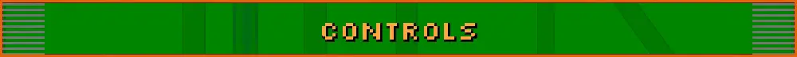

These are the defaults. Change them under OPTIONS > CONTROLS (or SECOND HUNT SETTINGS > CONTROLS). The sub-tabs are
BUTTONS, AIM, GYRO and TOUCH, and the last two only show on devices that have them. On a PC, the CONTROLS FOR row
switches between CONTROLLER and KEYBOARD & MOUSE.

Every game button can be rebound, combos included. The sticks, Start and the buttons in menus and dialogs stay put.

- [Controller](#controller)
- [Keyboard and mouse](#keyboard-and-mouse)
- [Touch](#touch)
- [Gyro](#gyro)

## Controller

Xbox-style layout: A bottom, B right, X left, Y top. On Windows, BUTTONS has a NINTENDO LAYOUT row for controllers
with A on the right.

| Input | Action |
|---|---|
| Left stick | Move. With STICK CURVE on MODERN (CONTROLS > AIM > MOVE, the default) a light tilt walks and rolls slowly and a full tilt moves at full speed; CLASSIC moves at full speed at any tilt, like the DS d-pad. |
| Right stick | Aim |
| R2 or B | Fire (lay bombs in morph ball) |
| A or L1 | Jump (boost in morph ball) |
| X | Morph ball |
| Hold L2 + right stick | Weapon ring: point at a weapon (it stays picked when you let go of the stick), let go of L2 to equip it. Works while you move. |
| L2 with the Imperialist | Zoom. The weapon ring then needs a short hold of L2 to open. |
| Y or L2 | Scan, with the scan visor on |
| R1 | Switch between missiles and the Power Beam |
| D-pad left / right | Previous / next weapon (only weapons you have, with ammo) |
| D-pad up | Scan visor on/off (campaign) |
| D-pad down | Missiles |
| D-pad up / down while zoomed | Zoom in / out, with ZOOM STEP on (CONTROLS > AIM > ZOOM) |
| R3 | Push to talk (online) |
| Select | Map (campaign). In a match, hold it for the live scoreboard. |
| Start | Pause menu |
| A / B in dialogs | OK or YES / NO (the press that closes a dialog doesn't also jump or fire) |
| Android Back (button or gesture) | Pause menu. In a menu, the map or the ship, it works like B. It never quits the game. |

**Scout Drone** (the Pirate Trooper's alt form) has its own buttons, in the SCOUT DRONE section of the remapper:

| Input | Action |
|---|---|
| X | Send out the drone, or call it back |
| R2 or B | Blasters (hold) |
| L2 | Cutting laser |
| A or L1 | Rise (hold), let go to sink |

A few functions have no button until you give them one: CHAT (the quick message wheel, with a CHAT MODE row for
hold or toggle), GYRO (see [Gyro](#gyro)) and L3.

## Keyboard and mouse

Windows only. A controller works on Windows too, with the buttons above.

| Input | Action |
|---|---|
| W A S D | Move |
| Hold Left Shift | Slow move: walk and roll slower with W A S D, for careful moves on ledges and small platforms, in every alt form. How slow (25, 40 or 60%) is CONTROLS > AIM > MOVE > SLOW MOVE SPEED, with CONTROLS FOR on KEYBOARD & MOUSE. |
| Mouse | Aim. Its sensitivity is under CONTROLS > AIM, with CONTROLS FOR on KEYBOARD & MOUSE. |
| Left click | Fire |
| Right click | Zoom with the Imperialist, or scan with the scan visor on |
| R / F while zoomed | Zoom in / out, with ZOOM STEP on |
| Space | Jump (boost in morph ball) |
| C | Morph ball |
| Q | Lay bombs in morph ball (left click does too), or scan with the scan visor on |
| E | Scan visor on/off |
| Mouse wheel | Next / previous weapon (only weapons you have, with ammo) |
| Hold middle click | Weapon ring: move the mouse toward a weapon, let go to equip it |
| 1 to 0 | Power Beam, missiles, Volt Driver, Battlehammer, Imperialist, Judicator, Magmaul, Shock Coil, Omega Cannon, Pirate Blaster |
| Arrow keys | The controller's D-pad |
| Esc | Pause menu (also backs out of menus, the map and the ship's screens) |
| Tab | Hold for the live scoreboard in a match |
| M | Map (campaign) |
| V | Push to talk (online) |
| Enter or T | Type a chat message (online) |
| F11 or Alt+Enter | Full screen |
| Space, Enter or left click in dialogs | OK or YES (Backspace or right click is NO) |

With the Scout Drone out: left click fires the blasters, right click is the cutting laser and Space rises.

MOUSE ROLL (CONTROLS > AIM > MOVE, off by default): in the rolling alt forms (Samus, Kanden, Spire and Noxus) moving the
mouse rolls the ball, like dragging the stylus on the DS touch screen, and the view follows the ball. Space still boosts.

In menus, the arrow keys or W A S D move, Enter or Space choose, Esc or Backspace go back, Q / E or Page Up / Page
Down change pages, Tab is Start, Z / C are L2 / R2, and the mouse clicks anything the DS touch screen would.

## Touch

The touch overlay has a move stick on the left half of the screen and an aim stick on the right, with buttons for
fire, jump, morph, missile, weapon and pause.

- Hold WEAPON and drag toward a weapon like the DS stylus, or tap one on the ring.
- MISSILE reads POWER BEAM while missiles are selected, and switches you back.
- ZOOM shows up with the Imperialist in hand, and OMEGA while the Omega Cannon is waiting in its slot.
- VISOR, SCAN and MAP show up in the campaign.
- CHAT shows up in online games, and TALK when voice chat is set to push to talk.
- With the Scout Drone out, FIRE reads BURST, JUMP reads RISE, MORPH reads RECALL, and a LASER button shows up.
- In dialogs, JUMP is OK/YES and FIRE is NO.

The right half also works like the DS touch screen: double tap to jump, and in morph ball drag to roll and flick to
boost. The touch buttons keep their jobs whatever the controller's buttons are changed to.

Under CONTROLS > TOUCH:

- TOUCH CONTROLS: AUTO (only while no controller is connected), ON, AIM ONLY or OFF
- TOUCH AIM: STICK, or STYLUS to aim like the DS
- AIM WHILE FIRING (on by default) lets the thumb on FIRE aim too

## Gyro

Tilt the device, or a controller with a gyro (on Android or Windows), to fine-tune your aim. The right stick still
works as normal, and the gyro adds on top of it. On Windows the GYRO sub-tab shows up once a controller with a gyro
has been connected.

CONTROLS > GYRO has the speed, axis (YAW, ROLL, or YAW+ROLL to turn fully at any aim height), invert, deadband,
smoothing and acceleration, and a separate speed for the Imperialist. GYRO BUTTON sets what the gyro button does:
ALWAYS ON, HOLD TO AIM, HOLD TO PAUSE or TOGGLE. Bind the button itself under BUTTONS.
