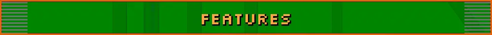

Everything Second Hunt adds to _Metroid Prime Hunters_. The short version is on the [front page](../README.md).
Anything from the Prime games needs your own disc, imported from OPTIONS > SECOND HUNT SETTINGS > IMPORT GAMES.
Nothing from any game ships with Second Hunt.

- [Arenas](#arenas)
- [Hunters and skins](#hunters-and-skins)
- [Online and multiplayer](#online-and-multiplayer)
- [Campaign](#campaign)
- [Replays](#replays)
- [Music and sound](#music-and-sound)
- [Controls](#controls)
- [Looks and HUD](#looks-and-hud)
- [Plays like the original](#plays-like-the-original)
- [In the works](#in-the-works)

## Arenas

- _Echoes_ arenas from your own _Metroid Prime 2: Echoes_ disc: Sidehopper Station, Spires, Crossfire Chaos, Pipeline,
  Spider Complex and Shooting Gallery, in every mode
- Drawn like _Echoes_, in HD, with its real lighting, materials, effects, glass, water and skies
- Played like _Echoes_, with double jump, Gravity Boost in Pipeline's water, jump pads that replace morph ball
  cannons, and _Echoes_' multiplayer music
- Shooting Gallery's turret works just like it does in _Echoes_. Climb in and fire on the arena, or roll into the slot
  behind it in any alt form and bomb it.
- Mining Plaza, a brand new arena made from the Mining Plaza room in _Echoes_' campaign, with its doors sealed, new
  pickups and a chain of three jump pads
- An EXTRA ARENAS playlist in FIND GAME for the _Echoes_ arenas

## Hunters and skins

- The Trooper from _Metroid Prime_, a Space Pirate with four skins, a wall cling, a Scout Drone alt form with its own
  laser, and the Pirate Blaster. A full burst puts a Squad Mark on a target, showing them through walls to the Trooper
  and his team.
- Dark Samus from _Echoes_ or _Corruption_, and Overcharged Dark Samus (her final form from _Echoes_) as a skin with its
  own morph ball. No Dark Samus imported? Pick Limoki's low-poly Dark Samus.
- HD Samus suits from every Prime game you import, the beta Phazon Suit included, in your pick of colors
- Sylux in his _Metroid Prime 4: Beyond_ suit, with his own arm cannon
- Flourishes when hunters stand still. Sylux has two.
- Stand-ins for players who haven't imported a hunter. They still see the Trooper in his skin's colors, Dark Samus as
  Limoki's low-poly Dark Samus, and HD Samus or _Beyond_ Sylux as the original MPH Samus or Sylux.
- HUD portraits for the Trooper and Dark Samus in the hit box and on the scoreboard
- Team and same-hunter colors for the new hunters, like the original's
- A color picker that shows your hunter in each color

## Online and multiplayer

- 8 players in every mode, any mix of people and bots. Matches of 4 or fewer play exactly like the original.
- Crossplay between Android and Windows on Second Hunt's own servers
- FIND GAME groups you with other players and everyone votes on the arena. You can also browse open games, or host
  your own with your rules and bots.
- Friends, rivals and parties like the original's, with head to head records
- Voice chat (push to talk or always on) and text chat
- A live scoreboard. Hold Select in a match to see everyone's score and ping.
- Automatic rejoin if your connection drops
- LAN and bot matches in every mode and arena. Bots run on the game's own bot code, take jump pads, ledges and
  drop-downs, and the new hunters fight as bots too. You can set the bots' level for online matches you host.
- EXTRA rules for hosts, to turn the extra pickups (the Pirate Blaster among them) and the extra characters on or off
- The Gaming Hub is back. The old Nintendo WFC pages for _Hunters_ are rebuilt in the game, with leaderboards and
  everyone's license stats.
- Hunter License rank and stats like the original, and you can bring your license over from your DS save
- STREAMING switches that hide your IP address, name and friend code on screen

## Campaign

- The whole campaign, from the opening to Gorea, with the game's own menus, gunship, cutscenes, scans and both endings
- Play it as any hunter after your first clear, the Trooper included
- Bring your DS save over, or export yours back out to play on a DS or an emulator
- UNLOCKS ALL and LOGBOOK SCANS ALL switches, if you just want to look around
- Alt-form hop (next update). Jump hops any alt form up to bomb jump height, so every hunter can get where Samus can,
  and morph ball doors open for every hunter.

## Replays

- Your last ten matches are kept, online ones included
- Instant seeking, any player's view and a free camera
- Send them to friends or save them as files

## Music and sound

- Music from every Prime game you import, picked song by song for matches, menus and the lobby
- HQ music that takes out the DS's clicks and clipping
- Each _Echoes_ arena's own music

## Controls

The full button lists are on the [Controls](CONTROLS.md) page.

- Dual sticks on any controller, and full rebinding, button combos included
- A weapon ring on L2. Hold it and point the right stick at a weapon.
- Gyro aim on phones, handhelds and controllers with a gyro, on top of the stick. Pick yaw or roll, filter the noise,
  or turn it on with a button.
- A touch overlay with the DS's own touch moves (double tap to jump, drag to roll and flick to boost in morph ball), and
  stylus aim like the DS
- Keyboard and mouse on Windows, and SDL3 controllers there too (Switch Pro included)
- A Nintendo button layout for controllers with A on the right
- Imperialist zoom with its own sensitivity, and a smooth zoom
- TRY CONTROLS, a room to try your settings before a match

## Looks and HUD

- True widescreen at 60 fps, with a field of view from 80 to 130
- AIM VIEW, so the view follows your aim instantly, or trails it like the DS
- HUD sway on or off, and visor, helmet and HUD opacity, with readouts that can lock to the visor
- A hit direction indicator
- The campaign radar from the DS touch screen, on your HUD
- Third person in the campaign and in bot and LAN matches
- The two DS screens merged into one, with clean redrawn HUD lines
- Art of your hunters behind the settings menus, and a SECOND HUNT logo on the main menu (LOOK > MENUS turns it off)
- An option to skip the boot logos and go straight to the menu

## Plays like the original

Gameplay values are the DS game's. Anything that behaves differently is checked against the original and fixed, and
the fixes are listed on [MphRead's to-do list](MPHREAD_TODO.md).

## In the works

These aren't in public builds yet.

- _First Hunt_, the demo that came with the DS, as its own mode from your own cart, with its menus, the Regulator and
  Morph Ball rooms, Survivor and its multiplayer arenas
- Zero Suit Samus, with her own Paralyzer beam that stuns, and an army crawl for her alt form
- Dark Samus's Hyper Mode, with the Hyper Ball and Hyper Beam
- The Spider Ball for every hunter on _Echoes_' spider tracks, and the Grapple Beam
- High frame rates, 120 fps and up, with smooth frames on any screen
- New death animations, _First Hunt_'s collapse and ragdolls
- Lua mods and game modes made as mods, and a Hard Mode campaign with enemies from _First Hunt_ and the Prime games
