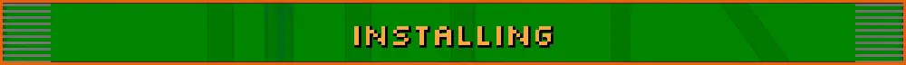

- [Android](#android)
- [Windows](#windows)
- [Updating](#updating)
- [Importing the Prime games](#importing-the-prime-games)

You'll need your own _Metroid Prime Hunters_ (USA) ROM, version 1.0 or 1.1 (game code AMHE). Other regions aren't
supported yet, and the app will tell you if your file is one of them.

## Android

You'll need an Android 8.0+ device with OpenGL ES 3.0. A controller is recommended, but touch controls work too.

1. Download the APK from [Releases](https://github.com/BountyHunterKanden/SecondHunt/releases).
2. Open it on your device. Android will ask you to allow installs from your browser or file manager.
3. On first launch, pick your ROM file. Second Hunt unpacks it once, and after that it goes straight into the game.

**Play Protect** may say the app is harmful. It isn't, and Google has been asked to review it. Until then, tap More
details, then Install anyway.

## Windows

You'll need Windows 10 or 11, 64-bit, with a graphics card or chip that has OpenGL 3.3 or newer, and a keyboard and
mouse or a controller.

1. Download the Windows zip from [Releases](https://github.com/BountyHunterKanden/SecondHunt/releases) and unzip it
   anywhere you can write to (not Program Files).
2. Open `SecondHunt.exe`. Windows may say it protected your PC, since the app isn't signed with a paid certificate.
   Click More info, then Run anyway.
3. On first launch, choose where to keep your files: APPDATA (`%LOCALAPPDATA%\Second Hunt`) or PORTABLE (a `data`
   folder next to the game). That folder holds your settings, saves, replays and online identity. You can
   move it later from SECOND HUNT SETTINGS > APP > FILES > DATA FOLDER.
4. Pick your ROM file or drop it on the window.

**Firewall.** For LAN and online matches, Windows Firewall has to let Second Hunt through. Windows usually asks the
first time you host or join, but the prompt can hide behind a full-screen window, and on a network set to Public
nothing gets through until it's allowed. If other devices can't see your match, or joining says no answer, go to
Windows Security > Firewall & network protection > Allow an app through firewall, add `SecondHunt.exe` and tick both
Private and Public.

## Updating

When a new version is out, the main menu asks if you want to update. You can also check any time from the main menu
with SECOND HUNT SETTINGS > APP > UPDATES > CHECK FOR UPDATES. Say yes and Second Hunt downloads the update, checks its
signature and installs it over the old one. Your saves and settings stay.

- **Android:** the first update asks you to let Second Hunt install apps, then Android asks you to confirm the update.
- **Windows:** the game restarts by itself when it's done.

UPDATE ALERTS on the same page turns off the check at launch.

## Importing the Prime games

The _Echoes_ arenas, the new hunters, the HD suits and the Prime music all come from your own copies of the Prime
games. Nothing from them ships with Second Hunt. Go to OPTIONS > SECOND HUNT SETTINGS > IMPORT GAMES and pick a disc
image or game file:

- _Metroid Prime_ and _Metroid Prime 2: Echoes_ (GameCube): `.iso`, `.gcm`, `.rvz` or `.wia`
- _Metroid Prime 3: Corruption_ from _Metroid Prime Trilogy_ (Wii): `.rvz` or `.wia`, or `.iso` / `.wbfs` with your
  own key file
- _Metroid Prime 4: Beyond_ (Switch): `.xci` or `.nsp`, with your own `prod.keys`

Second Hunt reads what it needs from the disc and keeps only that.
